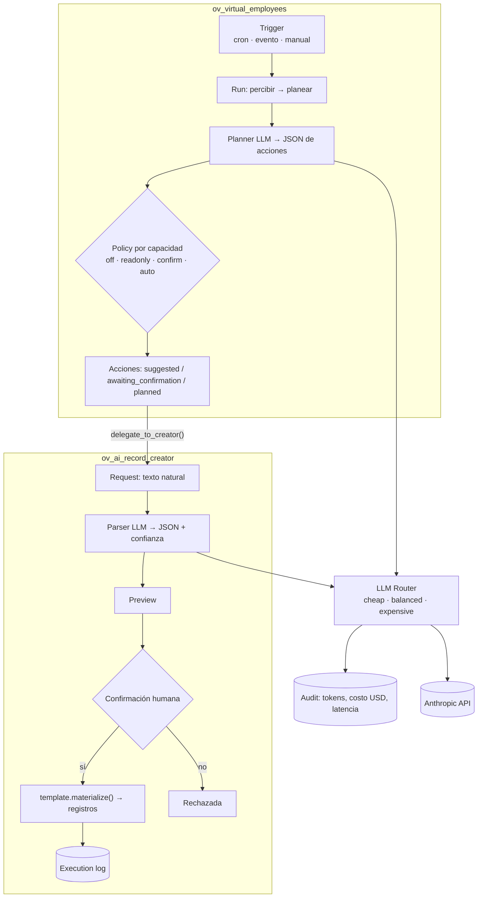

# odoo-ai-agents

> **EN:** Two Odoo 19 modules for *supervised* AI automation. `ov_ai_record_creator` turns natural language into Odoo records through templates, a preview and a mandatory confirmation gate, with a cost-aware LLM router and full audit of every call. `ov_virtual_employees` lets you "hire" virtual workers (starting with an accountant) with a four-level trust dial, per-capability autonomy, daily quotas and a USD budget that auto-pauses them.

Dos módulos de [OpenVoo](https://openvoo.pe) para automatizar trabajo en Odoo con IA **sin perder el control humano**.

| Módulo | Idea central |
|---|---|
| [`ov_ai_record_creator`](addons/ov_ai_record_creator) | "Crea 3 empleados: ..." → el LLM lo convierte en JSON estructurado, se muestra una **vista previa**, y solo tras **confirmación explícita** se escribe en la base. |
| [`ov_virtual_employees`](addons/ov_virtual_employees) | Empleados virtuales con ciclo *percibir → planear → actuar*, autonomía por capacidad y límites de costo. |

> **Dependencias:** ambos requieren el módulo [`sdr_chatbot`](https://github.com/gquispeh/openvoo-sdr-chatbot) (conector LLM) además de `hr`, `mail`, `product` y `account`. `ov_virtual_employees` requiere `ov_ai_record_creator`.

## Arquitectura



Flujos y máquinas de estados en [`docs/ARCHITECTURE.md`](docs/ARCHITECTURE.md).

## Decisiones de diseño

1. **Una sola puerta de escritura.** En `ov_ai_record_creator` el único camino que modifica el modelo destino es `action_confirm_and_execute()`, y exige estado `preview`. Todo lo anterior es lectura/vista previa.
2. **Router de modelos por costo.** `ov.ai.llm.router.complete(tier=...)` elige entre tres niveles (`cheap` / `balanced` / `expensive`) con precios de referencia por millón de tokens; el parseo usa el nivel barato por defecto y cada llamada (también las fallidas) deja una fila de auditoría con tokens, costo y latencia.
3. **Dial de confianza + política por capacidad.** `shadow → readonly`, `assisted → confirm`, `autonomous/trusted → auto` como valor por defecto, que el operador puede sobrescribir **por capacidad** (`off / readonly / confirm / auto`) y limitar con **cuota diaria**.
4. **El plan del LLM nunca se ejecuta tal cual.** Cada acción propuesta se valida contra las capacidades permitidas, la política y la cuota; si no pasa, queda `rejected` con el motivo en vez de ejecutarse.
5. **Presupuesto como freno automático.** Cada empleado tiene un tope diario en USD: al superarlo pasa a `over_budget` y se pausa; también respeta horario laboral y zona horaria.
6. **Falla segura.** Si el LLM devuelve algo que no es JSON, el plan queda vacío y se avisa en el hilo; si el parser falla, la solicitud queda `failed` con la advertencia.
7. **Acciones de alto riesgo en cola, no enviadas.** Los recordatorios de cobranza se dejan como `mail.mail` en la bandeja de salida (no se envían directamente desde el handler).

### Código: el plan se filtra antes de ejecutarse

De [`ov_ve_run.py`](addons/ov_virtual_employees/models/ov_ve_run.py) (recortado):

```python
if not cap or cap not in allowed_caps:
    state, why = 'rejected', _("Capability '%s' not in policy.") % code
elif not policy or policy.autonomy == 'off':
    state, why = 'rejected', _('Policy disabled.')
elif not policy.is_within_quota():
    state, why = 'rejected', _('Daily quota exhausted for this capability.')
elif policy.autonomy == 'readonly':
    state = 'suggested'
elif policy.autonomy == 'auto':
    state = 'planned'
else:                                  # 'confirm'
    state = 'awaiting_confirmation'
```

(Resumen de la lógica de `_materialize_actions`; el original crea el registro de acción en cada rama.)

## Capacidades incluidas (rol *contador*)

Conciliación bancaria (propuestas), registro de pagos a proveedores (delegado al *creator gate*), recordatorios de facturas vencidas (en bandeja de salida), detección de anomalías en facturas y checklist de cierre de período.

## Instalación

```bash
# 1. sdr_chatbot (conector LLM) — ver su repositorio
# 2. Copiar los módulos
cp -r addons/ov_ai_record_creator addons/ov_virtual_employees /ruta/a/addons/
odoo-bin -d <db> -i ov_virtual_employees --stop-after-init
```

Configura la API key en *Ajustes → SDR Chatbot* (la usa el router). El repo no contiene credenciales.

## Estado y pruebas

Código en uso interno de OpenVoo; **no incluye pruebas automatizadas todavía**. Los precios del router son referencias editables, no autoritativos. Antes de dar autonomía `auto` a una capacidad con efectos externos, empieza en `shadow` o `assisted`.

## Autor

**Gerardo Quispe** — fundador de [OpenVoo](https://openvoo.pe). Licencia [MIT](LICENSE).
