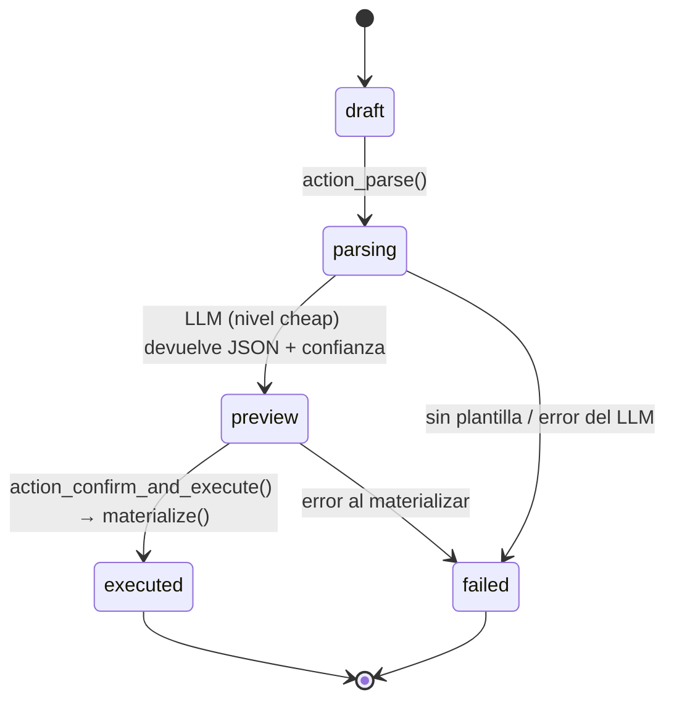
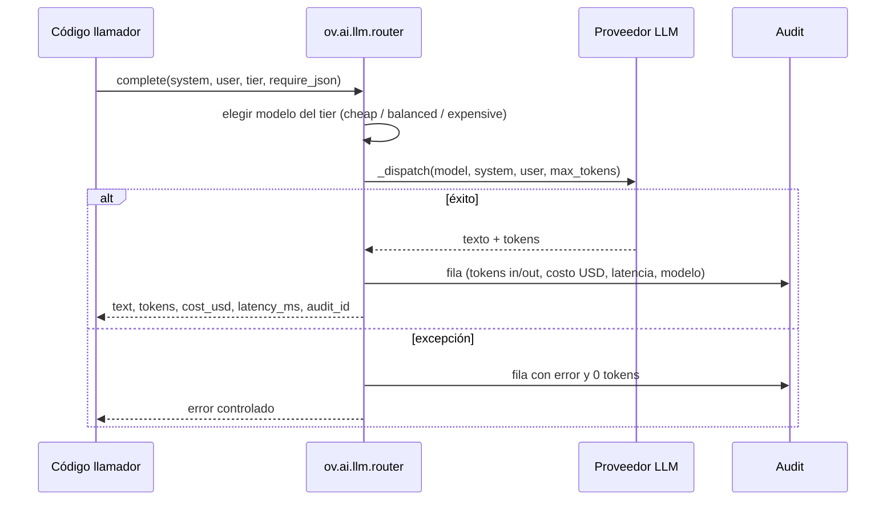
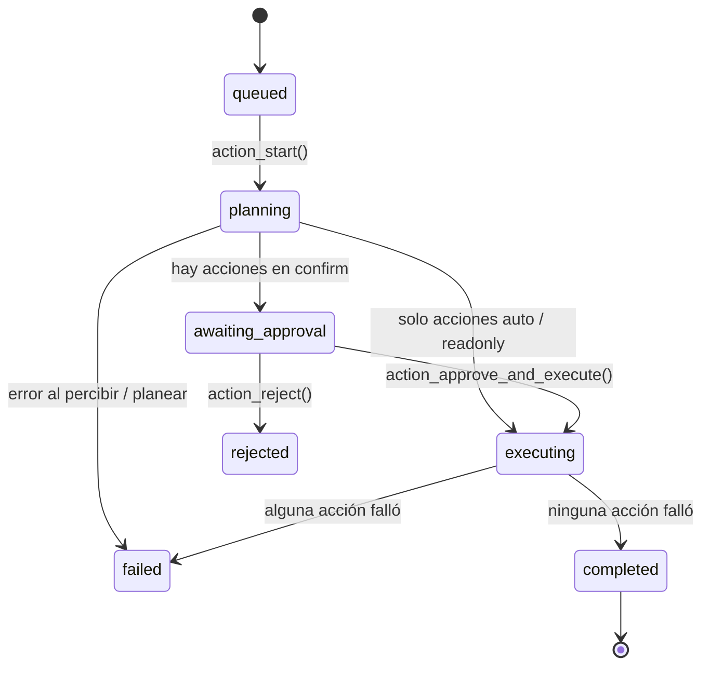
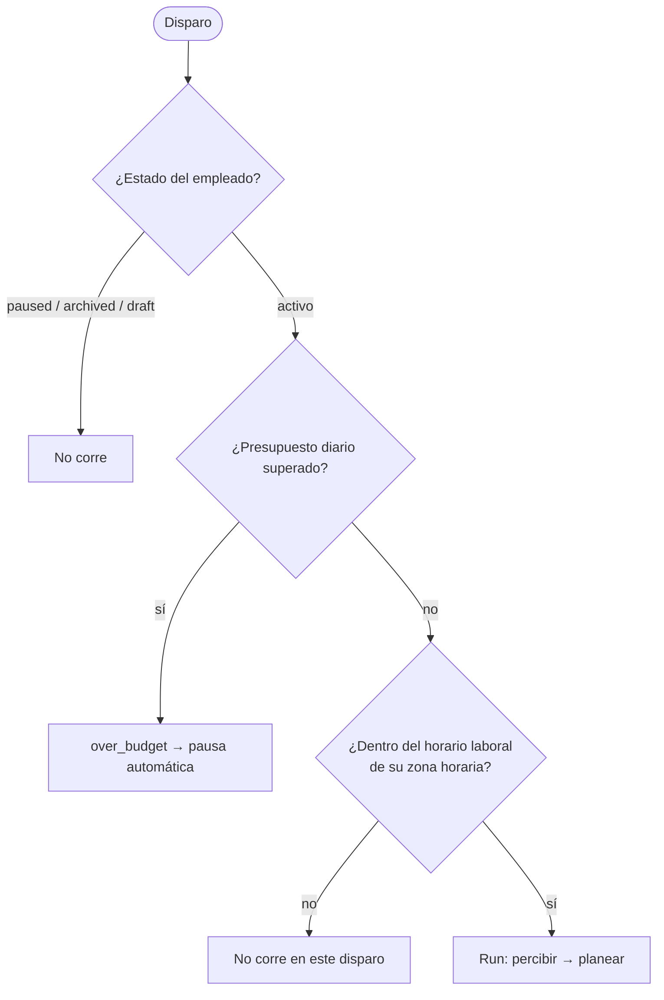

# Arquitectura

## Solicitud del Record Creator

El campo `confidence` y `warnings` se muestran en la vista previa: con confianza baja o campos obligatorios faltantes el usuario completa los huecos antes de confirmar.

## Router de LLM y auditoría

## Ciclo de un Run de empleado virtual

### Estados de una acción

| Estado | Significado |
|---|---|
| `suggested` | Capacidad en `readonly`: solo propone, nunca escribe |
| `awaiting_confirmation` | Capacidad en `confirm`: espera aprobación humana |
| `planned` | Capacidad en `auto`: se ejecuta en `_execute_all` |
| `executed` / `confirmed` | Ejecutada (directa / vía el *creator gate*) |
| `rejected` | Fuera de política, deshabilitada, sin cuota o rechazada por el operador |
| `failed` | El handler falló |

### Guardas de un empleado

### Trust dial

| Nivel | Autonomía por defecto |
|---|---|
| `shadow` | `readonly` |
| `assisted` | `confirm` |
| `autonomous` | `auto` |
| `trusted` | `auto` |

Sobrescribible por capacidad, con cuota diaria (`0` = ilimitada).
